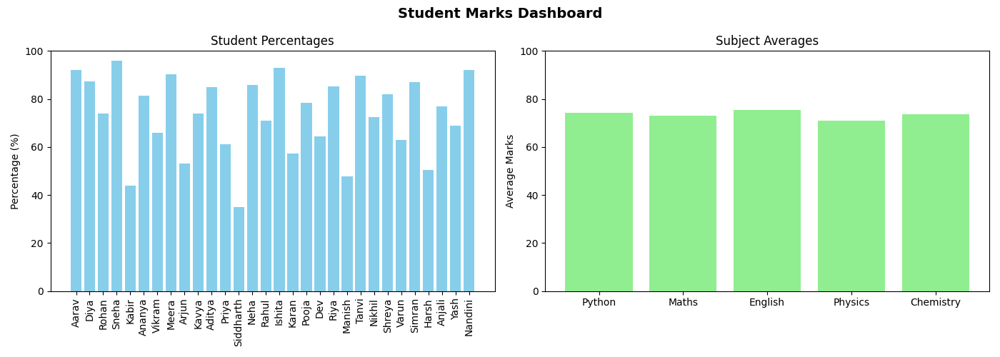

# 📊 Student Marks Analyzer 
## 📌 Project Overview

Student Marks Analyzer processes academic records using Python, automates performance calculations, and presents results through a visual dashboard.

The project focuses on transforming raw student data into structured performance reports and meaningful visual insights.

1. Data handling and processing.
2. File handling using CSV.
3. Mathematical calculations.
4. Conditional statements and functions.
5. Data analysis and visualization.
6. Presenting information in a structured format.


## ✨ Key Features

- **CSV Data Processing:** Reads and processes student records directly from CSV files.
- **Automated Calculations:** Computes total marks and percentage for each student.
- **Grade Classification:** Assigns grades based on predefined performance criteria.
- **Performance Reports:** Generates structured student-wise academic summaries.
- **Data Visualization:** Presents student performance and subject-wise comparisons through charts.

## 🛠️ Tech Stack

- **Language:** Python
- **Data Handling:** CSV Module
- **Data Structures:** Lists and Dictionaries
- **Core Concepts:** Functions, Loops, Conditional Statements, File Handling
- **Visualization:** Matplotlib (if used)

## 📂 Project Structure

```text
Student_Marks_Analyzer/
│
├── data/
│   └── students.csv
│
├── images/
│   └── dashboard.png
│
├── main.py
├── requirements.txt
├── README.md
└── .gitignore
```

## 🔄 How It Works

1. **Data Input:** Student names and subject marks are maintained in a structured CSV dataset.
2. **Data Extraction:** Python reads the dataset using the built-in CSV module.
3. **Data Processing:** Student records are extracted and organized using Python lists and dictionaries.
4. **Performance Analysis:** Total marks and percentages are calculated using mathematical operations.
5. **Grade Assignment:** A custom `get_grade()` function classifies students based on their percentages.
6. **Visualization:** Processed data is represented through charts for easier performance comparison.


## 🔄 Project Workflow

CSV Dataset (`students.csv`)
        ↓
Data Extraction (CSV Reader)
        ↓
Data Processing (Extract Names & Marks)
        ↓
Performance Calculation (Total & Percentage)
        ↓
Grade Classification (`get_grade()`)
        ↓
Store Processed Records (Lists & Dictionaries)
        ↓
Generate Student Performance Reports
        ↓
Dashboard Visualization (Matplotlib)
        ↓
Final Output (Academic Performance Analysis)


## 📊 Dashboard Preview

The dashboard provides two key visual insights:

- **Student Performance Analysis:** Compares individual student marks across subjects.
- **Subject-wise Performance:** Highlights average marks across different subjects.



## 🚀 How to Run

**1. Clone this repository.

**2. Create a virtual environment.

**3. Install the required dependencies.

**4. Run the Python program.

**5. Run python main.py

## 🎯 Key Learnings

- Practical implementation of Python programming fundamentals.
- Handling and processing structured datasets.
- Applying functions and logical conditions to real data.
- Automating repetitive calculations.
- Presenting analytical results through visualizations.

## 🔮 Future Enhancements

- Student ranking and performance comparison.
- Identification of top-performing students.
- Class average and subject-wise statistics.
- Interactive performance dashboard.
- Exportable student performance reports.

## 👨‍💻 Author

**Developed as a Python Data Analysis Project**

Exploring Python programming, data processing, and analytical problem-solving through practical implementation.
